<picture><source media="(prefers-color-scheme: dark)" srcset="assets/wordmark-dark.png"></picture>

<b>Türkçe</b> &nbsp;·&nbsp; <a href="docs/en/README.md">English</a> &nbsp;·&nbsp; <a href="docs/de/README.md">Deutsch</a> &nbsp;·&nbsp; <a href="docs/ru/README.md">Русский</a> &nbsp;·&nbsp; <a href="docs/zh/README.md">中文</a>

Ağ ve sistem yöneticisinin tek pencerelik araç çantası: keşif, yol ve hız, DNS, web, posta, uzaktan yönetim — kurulum, sürücü ve hesap gerektirmeden.

✓ Tek dosya, kurulum yok &nbsp;·&nbsp; ✓ Yönetici hakkı gerekmez &nbsp;·&nbsp; ✓ Windows · macOS · Linux &nbsp;·&nbsp; ✓ Veriler bilgisayarda kalır

## Ekran görüntüleri

### Keşif

#### Ping taraması

Bir /24 tek turda: gecikme, ARP, kayıp, ad ve MAC üreticisi; tek adrese 5 ping ya da sürekli.

#### Port tarama

Hazır profiller, servis karşılamaları, UDP sondaları; riskli portlar işaretli.

#### IP kimliği

"Bu IP ne?" Ping, portlar, SNMP, web ve MAC birleşip gerekçeli, puanlı tahmin.

#### MAC üretici

Her biçimde MAC → üretici; IP yazılırsa MAC bulunur. Sanal ve yerel adresler işaretli.

#### Komşuluk (LLDP/CDP)

Switch'ten switch'e keşif; port adları, LAG, yedi yerleşim, SVG / PNG / PDF.

### Yol ve hız

#### Traceroute / MTR

Ağ şeritleri, her atlamada kayıp ve gecikme, dünya haritası.

#### Hız testi

İnternete ya da kendi sunucunuza indirme / yükleme ölçümü.

#### Wi-Fi

Sinyal ölçer, kanal görünümü ve kapsama haritası.

#### Dosya indirici

Paralel bağlantılı hızlı indirme, doğrudan İndirilenler klasörüne; SHA-256 doğrulama.

#### MTU bulma

Parçalanmadan geçen en büyük paket; kara delik tespiti.

### DNS ve adres

#### DNS sorgu

Kayıt türleri, birden çok sunucuyu yan yana karşılaştırma, DNSSEC, AXFR.

#### Whois

RDAP ve klasik whois: kayıt şirketi, kişiler, AS, konum, ham kayıt.

#### Genel IP'm

Genel adres, servis sağlayıcı ve DNS yönlendirmesinin tespiti.

### Web

#### HTTP/HTTPS özeti

Durum kodu, yönlendirme, güvenlik başlıkları ve ürün tahmini.

#### HTTP istek (curl)

DNS, TCP, TLS, ilk bayt ayrı ayrı; JavaScript ile çalışan sayfalar da.

#### API istemcisi

Postman gibi, ama sade: koleksiyonlar, değişkenler, kimlik.

#### Sertifika

Zincir, bitiş tarihi, güven ve TLS sürümleri.

#### SSL denetimi

SSL Labs ölçütlerine yakın A+ … F notu ve nedenleri.

### Yönetim

#### Toplu işlem

SSH / WinRM ile yüzlerce makinede komut; şablonlar, birden çok kimlik.

#### Mail

SMTP, MX + SPF / DMARC, IMAP / POP3, deneme iletisi ve relay testi.

#### SNMP

Walk / get, v1–v3; yayın kipinde bilgisayar bir SNMP cihazı gibi yanıt verir.

#### Syslog

İleti gönder ya da sunucu olup gelenleri dinle.

#### Port mesaj / dinle

TCP / UDP portuna mesaj gönder, yanıtı ya da gelenleri izle.

#### Paket yakalama

Npcap'siz hafif yakalama, protokol özeti ve pcap kaydı.

#### Wake-on-LAN

Sihirli paketle uyandır, açılmasını ping ile izle.

### Hesap ve bilgi

#### Alt ağ hesap

Ağ, yayın, kullanılabilir aralık, maske ve bölme.

#### Bu bilgisayar

Arayüzler, adresler, ağ geçidi, DNS ve VPN.

## Neden AdminsTools

- **Hızlı, ama bilgisayarı kasmaz** — Pingler düzenli akışla gider: anahtarlama cihazları yorulmaz, yanıt kaybolmaz. Program düşük öncelikte ve birkaç çekirdekle çalışır.
- **Güçlü süzgeç** — Hazır düğmeler, sayılı değer listeleri, aralıklar ve kısa arama dili: `vendor:hp rtt>20 -down`. Satırlar yerinden oynamaz.
- **Sonuç geçmişi ve dışa aktarma** — Her çalıştırma saklanır, adıyla kaydedilir. Excel, CSV, pcap, SVG / PNG / PDF; dosyalar doğrudan İndirilenler'e.
- **Şifre kasası** — SSH, WinRM, SNMP v3 ve mail şifreleri Argon2id + AES-GCM ile şifreli kasada; ayar ve sonuç dosyalarına yazılmaz.
- **Veri bilgisayarınızda** — Hesap, bulut, telemetri yok. Arayüz yalnızca 127.0.0.1'de ve oturum anahtarıyla açılır.
- **5 dil, 9 tema** — Türkçe, English, Deutsch, Русский, 中文. Açık ve koyu temalar; sütun genişlikleri ve görünümler hatırlanır.

## İndir

Sürüm 2.20.0 · Tek dosya: indirin ve çalıştırın. Ayarlar tek bir dosyada; exe'nin yanına `PowerAdminTool.json` koyarsanız USB bellekten taşınabilir çalışır.

**Windows** — `AdminsTools-2.20.0.exe · ~16 MB`

- Windows 10 / 11, 64 bit
- Kurulum ve yönetici hakkı gerekmez
- Ping ve traceroute sürücü istemez

**macOS** — `AdminsTools-2.20.0-macos-arm64.zip · -macos-amd64.zip`

- Apple Silicon (M1 ve sonrası) ya da Intel
- İmzasız: ilk açılışta sağ tık › Aç
- Paket yakalama macOS'ta yok

**Linux** — `adminstools-2.20.0-linux-amd64 · ~15 MB`

- x86-64, tek ikili dosya
- `-listen 0.0.0.0:8090` ile atlama sunucusunda tarayıcıdan
- Ping için `ping_group_range` ya da `cap_net_raw`

---

© 2026 Mehmet Göğebakan
