<picture><source media="(prefers-color-scheme: dark)" srcset="../../assets/wordmark-dark.png"></picture>

<a href="../../README.md">Türkçe</a> &nbsp;·&nbsp; <a href="../../docs/en/README.md">English</a> &nbsp;·&nbsp; <b>Deutsch</b> &nbsp;·&nbsp; <a href="../../docs/ru/README.md">Русский</a> &nbsp;·&nbsp; <a href="../../docs/zh/README.md">中文</a>

Der Werkzeugkasten für Netzwerk- und Systemadministratoren in einem Fenster: Erkennung, Pfad und Geschwindigkeit, DNS, Web, Mail, Fernverwaltung — ohne Installation, Treiber oder Konto.

✓ Eine Datei, keine Installation &nbsp;·&nbsp; ✓ Keine Administratorrechte nötig &nbsp;·&nbsp; ✓ Windows · macOS · Linux &nbsp;·&nbsp; ✓ Daten bleiben auf dem Computer

## Screenshots

### Erkennung

#### Ping-Sweep

Ein /24 in einer Runde: Latenz, ARP, Verlust, Name und MAC-Hersteller; 5 Pings oder dauerhaft an eine Adresse.

#### Portscan

Fertige Profile, Dienst-Banner, UDP-Sonden; riskante Ports markiert.

#### IP-Identität

„Was ist diese IP?“ Ping, Ports, SNMP, Web und MAC ergeben eine begründete, bewertete Schätzung.

#### MAC-Hersteller

MAC → Hersteller in jedem Format; bei einer IP wird die MAC ermittelt. Virtuelle und lokal verwaltete Adressen markiert.

#### Nachbarschaft (LLDP/CDP)

Erkennung von Switch zu Switch; Portnamen, LAG, sieben Layouts, SVG / PNG / PDF.

### Pfad und Geschwindigkeit

#### Traceroute / MTR

Netzwerkspuren, Verlust und Latenz pro Hop, Weltkarte.

#### Geschwindigkeitstest

Download-/Upload-Messung ins Internet oder zum eigenen Server.

#### Wi-Fi

Signalmesser, Kanalansicht und Abdeckungskarte.

#### Datei-Downloader

Schnelle Downloads über parallele Verbindungen, direkt in den Downloads-Ordner; SHA-256-Prüfung.

#### MTU-Ermittlung

Größtes Paket, das unfragmentiert durchkommt; Erkennung von Black Holes.

### DNS und Adresse

#### DNS-Abfrage

Eintragstypen, mehrere Server nebeneinander vergleichen, DNSSEC, AXFR.

#### Whois

RDAP und klassisches Whois: Registrar, Kontakte, AS, Standort, Rohdaten.

#### Meine öffentliche IP

Ermittelt öffentliche Adresse, Provider und DNS-Umleitung.

### Web

#### HTTP/HTTPS-Übersicht

Statuscode, Weiterleitungen, Sicherheitsheader und Produkterkennung.

#### HTTP-Anfrage (curl)

DNS, TCP, TLS und erstes Byte einzeln; auch Seiten, die JavaScript benötigen.

#### API-Client

Wie Postman, aber schlicht: Sammlungen, Variablen, Identität.

#### Zertifikat

Kette, Ablaufdatum, Vertrauen und TLS-Versionen.

#### SSL-Prüfung

Eine Note von A+ … F nahe an den SSL-Labs-Kriterien, mit Begründung.

### Verwaltung

#### Stapelverarbeitung

Befehle auf Hunderten von Rechnern per SSH / WinRM; Vorlagen, mehrere Identitäten.

#### Mail

SMTP, MX + SPF / DMARC, IMAP / POP3, Testnachricht und Relay-Test.

#### SNMP

Walk / Get, v1–v3; im Broadcast-Modus antwortet der Computer wie ein SNMP-Gerät.

#### Syslog

Nachricht senden oder als Server eingehende Nachrichten empfangen.

#### Port-Nachricht / Lauschen

Nachricht an einen TCP- / UDP-Port senden und die Antwort oder eingehenden Verkehr beobachten.

#### Paketaufzeichnung

Leichte Aufzeichnung ohne Npcap, Protokollübersicht und pcap-Speicherung.

#### Wake-on-LAN

Per Magic Packet aufwecken, und den Start per Ping verfolgen.

### Konto und Info

#### Subnetz berechnen

Netzwerk, Broadcast, nutzbarer Bereich, Maske und Aufteilung.

#### Dieser Computer

Schnittstellen, adresler, Gateway, DNS und VPN.

## Neden AdminsTools

- **Schnell, aber der Computer bleibt flüssig** — Pings gehen in gleichmäßigem Strom hinaus: Switches werden nicht überlastet, keine Antwort geht verloren. Das Programm läuft mit niedriger Priorität auf wenigen Kernen.
- **Starker Filter** — Fertige Schaltflächen, Wertelisten mit Anzahl, Bereiche und eine kurze Suchsprache: `vendor:hp rtt>20 -down`. Zeilen bleiben an ihrem Platz.
- **Ergebnisverlauf und Export** — Jeder Lauf wird aufbewahrt und unter seinem Namen gespeichert. Excel, CSV, pcap, SVG / PNG / PDF; Dateien direkt in den Downloads-Ordner.
- **Passworttresor** — SSH-, WinRM-, SNMP-v3- und Mail-Passwörter liegen in einem mit Argon2id + AES-GCM verschlüsselten Tresor; sie landen nie in Einstellungs- oder Ergebnisdateien.
- **Ihre Daten bleiben auf Ihrem Computer** — Kein Konto, keine Cloud, keine Telemetrie. Die Oberfläche öffnet sich nur auf 127.0.0.1 und mit Sitzungsschlüssel.
- **5 Sprachen, 9 Designs** — Türkisch, Englisch, Deutsch, Russisch, Chinesisch. Helle und dunkle Designs; Spaltenbreiten und Ansichten werden gespeichert.

## Herunterladen

Version 2.21.0 · Eine Datei: herunterladen und starten. Die Einstellungen stehen in einer Datei; legen Sie `PowerAdminTool.json` neben die exe, dann läuft es portabel vom USB-Stick.

**Windows** — `AdminsTools-2.21.0.exe · ~16 MB`

- Windows 10 / 11, 64 bit
- Keine Installation und keine Administratorrechte nötig
- Ping und Traceroute ohne Treiber

**macOS** — `AdminsTools-2.21.0-macos-arm64.zip · -macos-amd64.zip`

- Apple Silicon (M1 und neuer) oder Intel
- Nicht signiert: beim ersten Start Rechtsklick › Öffnen
- Keine Paketaufzeichnung unter macOS

**Linux** — `adminstools-2.21.0-linux-amd64 · ~15 MB`

- x86-64, eine einzige Binärdatei
- `-listen 0.0.0.0:8090` für den Browserzugriff auf einem Jump-Server
- Für Ping: `ping_group_range` oder `cap_net_raw`

---

© 2026 Mehmet Göğebakan
