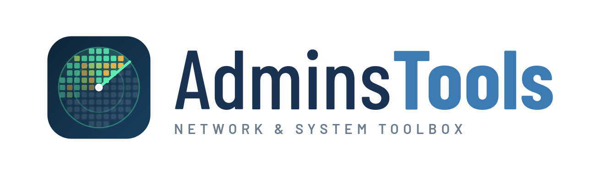

<picture><source media="(prefers-color-scheme: dark)" srcset="../../assets/wordmark-dark.png"></picture>

<a href="../../README.md">Türkçe</a> &nbsp;·&nbsp; <a href="../../docs/en/README.md">English</a> &nbsp;·&nbsp; <a href="../../docs/de/README.md">Deutsch</a> &nbsp;·&nbsp; <b>Русский</b> &nbsp;·&nbsp; <a href="../../docs/zh/README.md">中文</a>

Набор инструментов сетевого и системного администратора в одном окне: обнаружение, маршрут и скорость, DNS, веб, почта, удалённое управление — без установки, драйверов и учётных записей.

✓ Один файл, без установки &nbsp;·&nbsp; ✓ Не нужны права администратора &nbsp;·&nbsp; ✓ Windows · macOS · Linux &nbsp;·&nbsp; ✓ Данные остаются на компьютере

## Снимки экрана

### Обнаружение

#### Ping-сканирование

/24 за один проход: задержка, ARP, потери, имя и производитель по MAC; 5 пингов или непрерывно на один адрес.

#### Сканирование портов

Готовые профили, баннеры служб, UDP-зонды; опасные порты отмечены.

#### Идентификатор IP

«Что это за IP?» Ping, порты, SNMP, веб и MAC сводятся в обоснованную оценку с баллами.

#### Производитель по MAC

MAC → производитель в любом формате; по IP находится MAC. Виртуальные и локально администрируемые адреса отмечены.

#### Соседство (LLDP/CDP)

Обнаружение от коммутатора к коммутатору; имена портов, LAG, семь раскладок, SVG / PNG / PDF.

### Маршрут и скорость

#### Traceroute / MTR

Сетевые полосы, потери и задержка на каждом узле, карта мира.

#### Тест скорости

Измерение скорости загрузки и отдачи до интернета или своего сервера.

#### Wi-Fi

Измеритель сигнала, обзор каналов и карта покрытия.

#### Загрузчик файлов

Быстрая загрузка в несколько потоков прямо в папку «Загрузки»; проверка SHA-256.

#### Определение MTU

Наибольший пакет, проходящий без фрагментации; обнаружение «чёрных дыр».

### DNS и адрес

#### DNS-запрос

Типы записей, сравнение нескольких серверов рядом, DNSSEC, AXFR.

#### Whois

RDAP и классический whois: регистратор, контакты, AS, местоположение, исходная запись.

#### Мой внешний IP

Определение внешнего адреса, провайдера и перенаправления DNS.

### Web

#### Сводка HTTP/HTTPS

Код состояния, перенаправления, заголовки безопасности и определение продукта.

#### HTTP-запрос (curl)

DNS, TCP, TLS и первый байт по отдельности; в том числе страницы на JavaScript.

#### API-клиент

Как Postman, только проще: коллекции, переменные, учётные данные.

#### Сертификат

Цепочка, срок действия, доверие и версии TLS.

#### Проверка SSL

Оценка A+ … F, близкая к критериям SSL Labs, с причинами.

### Управление

#### Массовая операция

Команды на сотнях машин через SSH / WinRM; шаблоны, несколько учётных записей.

#### Mail

SMTP, MX + SPF / DMARC, IMAP / POP3, тестовое письмо и проверка relay.

#### SNMP

Walk / get, v1–v3; в режиме трансляции компьютер отвечает как SNMP-устройство.

#### Syslog

Отправка сообщения или работа сервером с приёмом входящих.

#### Порт: сообщение / прослушивание

Отправка сообщения на порт TCP / UDP и просмотр ответа или входящих данных.

#### Захват пакетов

Лёгкий захват без Npcap, сводка по протоколам и запись в pcap.

#### Wake-on-LAN

Пробуждение магическим пакетом, и отслеживание включения по ping.

### Расчёт и сведения

#### Расчёт подсети

Сеть, широковещательный, диапазон адресов, маска и разбиение.

#### Этот компьютер

Интерфейсы, adresler, шлюз, DNS и VPN.

## Neden AdminsTools

- **Быстрый, но не тормозит компьютер** — Пинги идут равномерным потоком: коммутаторы не перегружаются, ответы не теряются. Программа работает с низким приоритетом на нескольких ядрах.
- **Мощный фильтр** — Готовые кнопки, списки значений со счётчиками, диапазоны и короткий язык запросов: `vendor:hp rtt>20 -down`. Строки не прыгают.
- **История результатов и экспорт** — Каждый запуск сохраняется под своим именем. Excel, CSV, pcap, SVG / PNG / PDF; файлы сразу в папку «Загрузки».
- **Хранилище паролей** — Пароли SSH, WinRM, SNMP v3 и почты хранятся в хранилище, зашифрованном Argon2id + AES-GCM; в файлы настроек и результатов не пишутся.
- **Данные остаются на вашем компьютере** — Без учётных записей, облака и телеметрии. Интерфейс открывается только на 127.0.0.1 и по ключу сеанса.
- **5 языков, 9 тем** — Турецкий, английский, немецкий, русский, китайский. Светлые и тёмные темы; ширина столбцов и виды запоминаются.

## Скачать

Версия 2.18.0 · Один файл: скачайте и запустите. Настройки хранятся в одном файле; положите `PowerAdminTool.json` рядом с exe, и программа будет работать с USB-накопителя.

**Windows** — `AdminsTools-2.18.0.exe · ~16 MB`

- Windows 10 / 11, 64 bit
- Не требует установки и прав администратора
- Ping и traceroute без драйверов

**macOS** — `AdminsTools-2.18.0-macos-arm64.zip · -macos-amd64.zip`

- Apple Silicon (M1 и новее) или Intel
- Без подписи: при первом запуске правый щелчок › Открыть
- Захват пакетов в macOS недоступен

**Linux** — `adminstools-2.18.0-linux-amd64 · ~15 MB`

- x86-64, один исполняемый файл
- `-listen 0.0.0.0:8090` — доступ из браузера на jump-сервере
- Для ping: `ping_group_range` или `cap_net_raw`

---

© 2026 Mehmet Göğebakan
